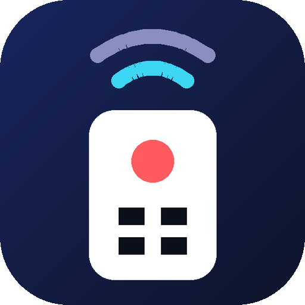
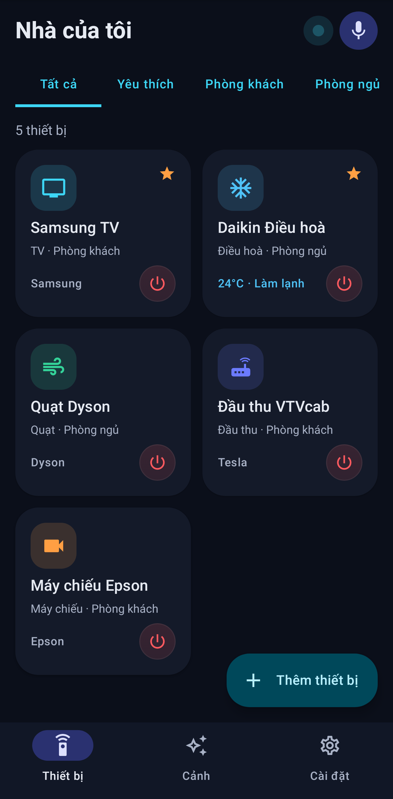
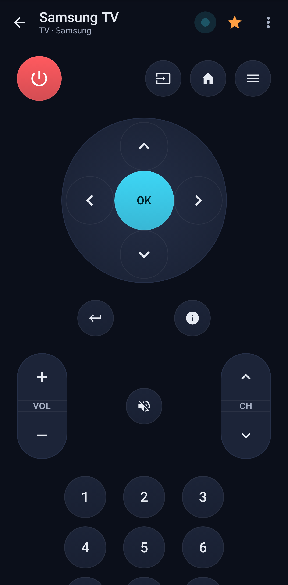
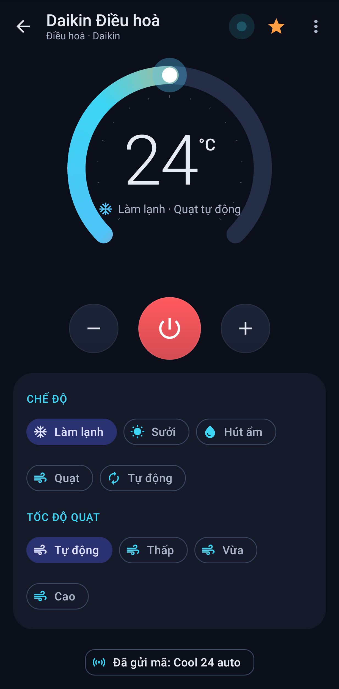
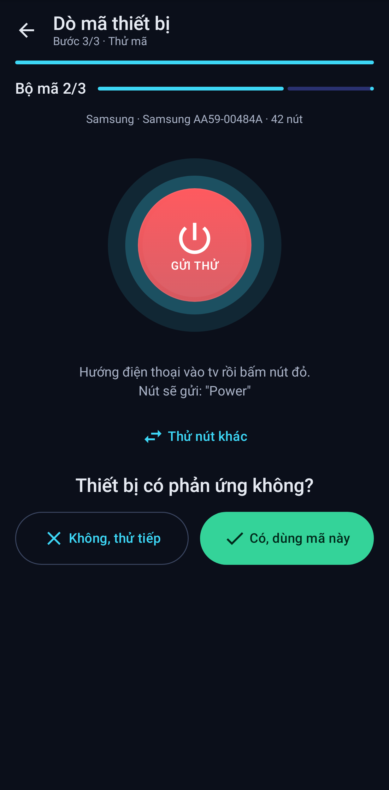
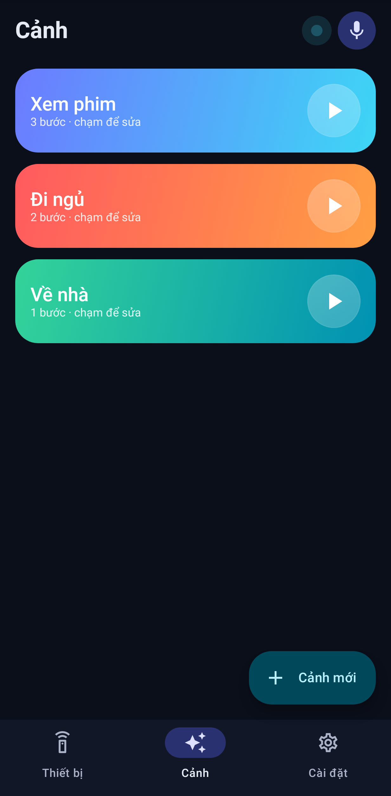
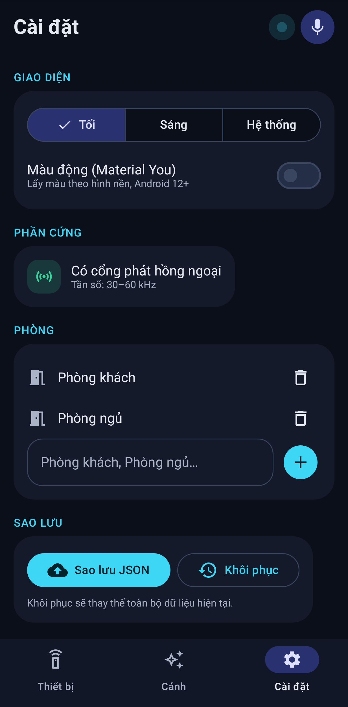
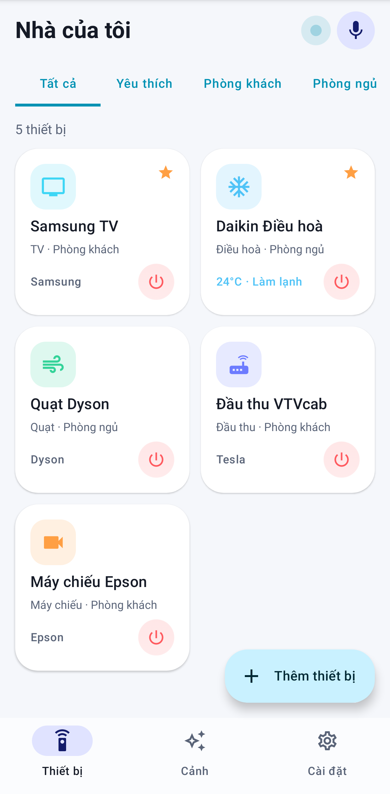
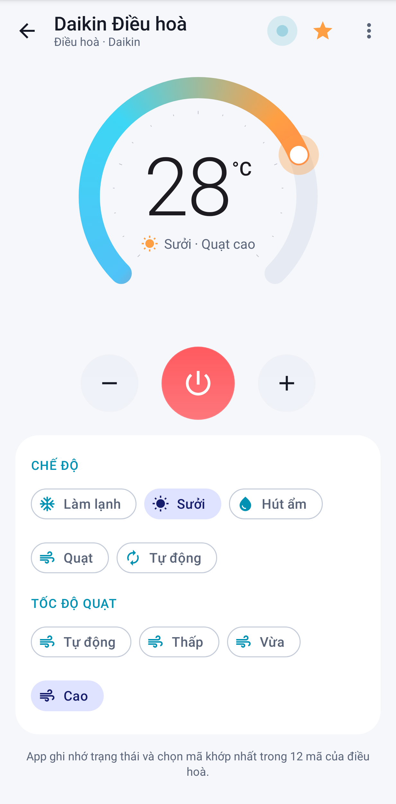
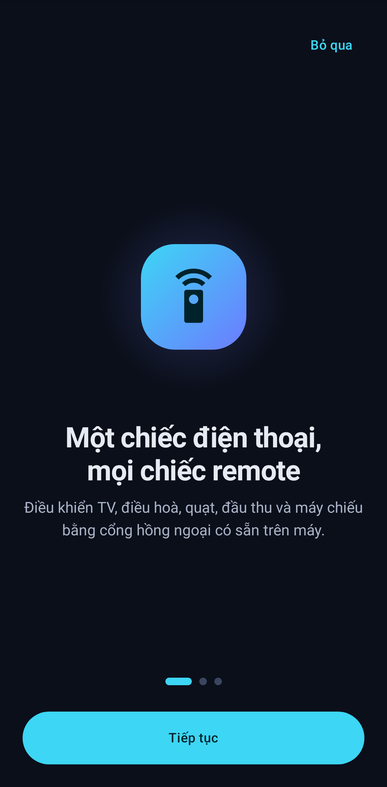

<div align="center">



# IR Remote VN

**Biến điện thoại có cổng hồng ngoại thành remote cho TV, điều hoà, quạt, đầu thu và máy chiếu.**<br/>
Miễn phí · Không quảng cáo · Không cần tài khoản · Mã nguồn mở

[](https://developer.android.com)
[](https://kotlinlang.org)
[](https://developer.android.com/jetpack/compose)
[](https://m3.material.io)
[](LICENSE)
[](https://github.com/gooduselabs/ir-remote/releases/latest)


<a href="https://github.com/gooduselabs/ir-remote/releases/latest"></a>

</div>

> [!WARNING]
> **Bản thử nghiệm sớm (debug build), chưa kiểm thử trên điện thoại thật.** Mã IR đã được kiểm tra bằng unit test và giao diện được chụp bằng Roborazzi, nhưng việc phát hồng ngoại thực tế chưa được xác minh. Rất mong nhận được báo cáo qua [Issues](https://github.com/gooduselabs/ir-remote/issues).

---

## 📸 Ảnh màn hình

| Màn chính | Remote TV | Điều hoà |
|:---:|:---:|:---:|
|  |  |  |
| **Dò mã** | **Cảnh** | **Cài đặt** |
|  |  |  |
| **Chế độ sáng** | **Điều hoà (sáng)** | **Giới thiệu** |
|  |  |  |

## ✨ Tính năng

**🎮 Điều khiển**
- 📺 TV, 📡 đầu thu, 🌀 quạt, ❄️ điều hoà, 📽️ máy chiếu
- 🕹️ Bố cục như remote thật: D-pad tròn, phím bập bênh âm lượng/kênh, bàn phím số, nút nguồn đỏ
- 📳 Phím có rung nhẹ, thu nhỏ khi nhấn và loé sáng khi phát mã
- 🌡️ Điều hoà nhớ trạng thái (nhiệt độ, chế độ, quạt). Vòng cung nhiệt độ kéo được, app tự chọn mã khớp nhất

**🔍 Thiết lập**
- 🪄 Dò mã từng bước: chọn loại → hãng → bấm thử → "Thiết bị có phản ứng không?"
- 📂 Nhập và xuất file `.ir` (định dạng Flipper Zero)
- ✏️ Tự tạo hoặc sửa nút: NEC, RC5, Samsung… hoặc dán Pronto Hex / raw

**⚡ Tiện ích**
- 🎬 Cảnh/macro: một chạm chạy nhiều lệnh, có độ trễ giữa các bước
- 🧩 Widget màn hình chính và ô Cài đặt nhanh
- 🎙️ Điều khiển bằng giọng nói tiếng Việt
- 🏠 Phòng, yêu thích

**🔒 Riêng tư**
- 🚫 Không quảng cáo, không tài khoản, không gửi dữ liệu ra ngoài (app không xin quyền Internet)
- 💾 Sao lưu và khôi phục bằng file JSON
- 🌓 Giao diện tối/sáng, màu động Material You (Android 12+)

## ⚖️ So sánh

| | IR Remote VN | App IR phổ biến (thường gặp) |
|---|:---:|:---:|
| Quảng cáo | ❌ Không | Thường có |
| Cần tài khoản / đăng nhập | ❌ Không | Tuỳ app |
| Quyền Internet / vị trí | ❌ Không | Thường xin |
| Mã nguồn mở | ✅ MIT | Hiếm |
| Lưu trạng thái điều hoà | ✅ | Tuỳ app |
| Cảnh / macro, widget | ✅ | Thường phải trả phí |
| Nhập file `.ir` / Pronto / raw | ✅ | Hiếm |
| Giọng nói tiếng Việt | ✅ | Hiếm |
| Kho mã thiết bị | ⚠️ Nhỏ (48 bộ, CC0) | Thường rất lớn |

## 📡 Giao thức hỗ trợ

Bộ mã hoá được tự viết theo đặc tả công khai và có unit test.

| Giao thức | Sóng mang | Ghi chú |
|---|---|---|
| NEC / NECext | 38 kHz | Địa chỉ 8 hoặc 16 bit |
| Samsung32 | 38 kHz | |
| RC5 / RC5X | 36 kHz | Philips, Manchester |
| RC6 (mode 0) | 36 kHz | Philips |
| SIRC 12/15/20 | 40 kHz | Sony, lặp 3 khung |
| Kaseikyo / Panasonic | 37 kHz | 48 bit |
| JVC | 38 kHz | |
| Pronto Hex | theo mã | Dạng `0000` (learned) |
| Raw | tuỳ chọn | Chuỗi µs mark/space |

## 📱 Yêu cầu thiết bị

- Android **7.0+** (API 24)
- Điện thoại **có cổng phát hồng ngoại (IR blaster)**, ví dụ nhiều máy **Xiaomi / Redmi / POCO** và một số máy **Huawei / Honor đời cũ**
- Nếu máy không có cổng IR, app vẫn chạy và báo rõ; bạn vẫn xem, sửa và sao lưu remote được
- Giọng nói cần dịch vụ nhận dạng giọng nói trên máy (thường là Google) và quyền micro

## 🛠️ Build

```bash
git clone https://github.com/gooduselabs/ir-remote.git && cd ir-remote
export ANDROID_HOME=~/android-sdk     # cần Android SDK 35, JDK 17+
./gradlew testDebugUnitTest assembleDebug
# APK: app/build/outputs/apk/debug/app-debug.apk
```
`testDebugUnitTest` chạy unit test cho bộ mã hoá, trình đọc file, điều hoà và giọng nói, đồng thời chụp lại ảnh màn hình bằng Roborazzi vào `../screens`.

## 🗂️ Cấu trúc dự án

```
app/src/main/java/vn/irremote/
├── ir/        # Bộ mã hoá giao thức, đọc/ghi .ir, xếp phím lên remote
├── ac/        # Trạng thái điều hoà và chọn mã khớp nhất
├── voice/     # Phân tích lệnh nói tiếng Việt
├── data/      # Room (phòng, remote, nút, cảnh), kho mã, sao lưu
├── hw/        # Bọc ConsumerIrManager
├── ui/        # Jetpack Compose (MVVM): theme, các màn hình, component
├── widget/    # Widget Glance và ô Cài đặt nhanh
└── App.kt
app/src/main/assets/irdb/   # 48 file .ir từ Flipper-IRDB (CC0)
app/src/test/               # Unit test và test chụp màn hình
docs/                       # Icon và ảnh màn hình
```

## 🎙️ Lệnh giọng nói

| Bạn nói | App làm |
|---|---|
| "Tắt tivi" / "Bật quạt" | Gửi nút nguồn của thiết bị |
| "Tăng âm lượng" / "Nhỏ lại" / "Tắt tiếng" | Âm lượng |
| "Kênh tiếp" / "Kênh 12" | Đổi kênh |
| "Điều hoà 25 độ" | Bật điều hoà và đặt 25°C |
| "Chế độ lạnh" / "Sưởi" / "Hút ẩm" | Đổi chế độ điều hoà |
| "Chạy cảnh xem phim" | Chạy cảnh có tên đó |

## 🗺️ Lộ trình

- [x] Bộ mã hoá cho 9 nhóm giao thức, có unit test
- [x] Dò mã từng bước, nhập/xuất `.ir`
- [x] Điều hoà lưu trạng thái
- [x] Cảnh, widget, ô nhanh, giọng nói, sao lưu JSON
- [x] Giao diện Material 3, chế độ tối/sáng, splash, icon thích ứng
- [ ] Kiểm thử trên điện thoại thật có IR
- [ ] Bản release có ký, phát hành trên F-Droid
- [ ] Mở rộng kho mã (thêm nguồn có giấy phép phù hợp)
- [ ] Học lệnh qua dongle USB / ESP32 / Broadlink
- [ ] Nhận diện model bằng ảnh tem (OCR trên máy)
- [ ] Widget đẹp hơn, Wear OS

## 🙏 Ghi công

- **[Flipper-IRDB](https://github.com/Lucaslhm/Flipper-IRDB)**: kho mã IR cộng đồng, giấy phép **CC0-1.0**. App kèm 48 file được thêm *sau* commit `2319685` (snapshot `d126fb1`), vì nội dung trước commit đó không thuộc CC0. Chi tiết ở `app/src/main/assets/irdb/SOURCE.txt`. Cảm ơn cộng đồng Flipper-IRDB.
- Timing giao thức tham khảo từ các đặc tả công khai. Không sao chép mã nguồn hoặc tài nguyên của app khác.
- Xây dựng với Kotlin, Jetpack Compose, Material 3, Room, Glance, Robolectric và Roborazzi.

## 📄 Giấy phép

Mã nguồn phát hành theo **[MIT](LICENSE)**. Các file mã IR trong `app/src/main/assets/irdb` dùng giấy phép **CC0-1.0** (xem `LICENSE-CC0.txt`).

---

<details>
<summary><b>🇬🇧 English summary</b></summary>

**IR Remote VN** is a free, open-source, ad-free Android app that turns phones with a built-in IR blaster (`ConsumerIrManager`) into a universal remote for TVs, ACs, fans, set-top boxes and projectors. It includes:

- clean-room encoders for NEC, NECext, Samsung32, RC5/RC5X, RC6, SIRC, Kaseikyo/Panasonic, JVC, Pronto and raw signals
- a step-by-step code-matching wizard
- AC state tracking
- scenes/macros, a Glance widget and a Quick Settings tile
- Vietnamese voice commands
- `.ir` import/export and JSON backup
- a Material 3 UI with dark and light modes

The starter codes come from Flipper-IRDB (CC0). **Early debug build, not yet tested on real hardware.** MIT licensed.
</details>
